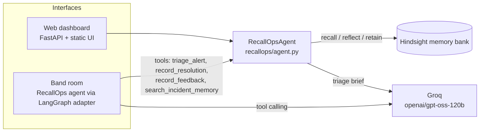

# RecallOps: the on-call copilot that remembers every incident

**HackwithHyderabad 3.0 · AI Agents That Learn Using Hindsight**

It's 3am, `payments-api` is throwing 5xx errors, and the on-call engineer has never seen this failure before. Someone on the team has. Six months ago Daniel spent 38 minutes finding that a `@Transactional` method was holding Postgres connections "idle in transaction". That knowledge sits in a post-mortem doc nobody will find in time.

**RecallOps** is an incident-response agent for SRE teams. Every resolved incident, root cause, working fix, and dead end goes into a shared [Hindsight](https://hindsight.vectorize.io/) memory bank. When a new alert fires, RecallOps recalls the similar incidents, reflects on patterns across them, and hands the responder a brief: likely cause, exact commands, what *not* to waste time on, and which past incidents it is drawing from. It runs as a web dashboard and as a teammate inside a [Band](https://www.band.ai) incident room.

> Would a team pay $50/month for this? One avoided hour of a sev1 payments outage pays for years of it.

## What memory changes

| | Generic LLM | RecallOps with Hindsight |
|---|---|---|
| ALERT-7781 payments-api 5xx after deploy | "Check recent deploys, check saturation, consider rollback" | "Same signature as INC-2026-0412: an outbound HTTP call inside a transaction. Roll back with `argocd app rollback`, kill idle-in-transaction sessions with this SQL. **Don't** raise the Hikari pool size, that only moved the problem in 0412 and 0117." |
| ALERT-7815 cert expired (never seen) | Generic | Generic, and honest about it: "looks new to the team" |
| *(on-call records the fix: a WAF rule blocked the ACME challenge path)* | n/a | Retained to memory |
| ALERT-7840 cert expired on a **different service**, a week later | Generic | "Matches INC-2026-1108: check the WAF for `/.well-known/acme-challenge/*`, then `cmctl renew`. Restarting ingress doesn't help." |

The agent gets better with every incident the team closes, and with every 👍/👎 a responder gives its suggestions.

## How Hindsight memory is used

All memory lives in one Hindsight bank per team (`HINDSIGHT_BANK_ID`, default `recallops-acme-sre`). The bank is created with a **mission** telling Hindsight what an SRE memory should keep (symptoms, root cause, fixes that worked, fixes that didn't, time to resolve) and a **reflect mission** so it answers like a senior SRE who has been through every incident.

| Hindsight operation | Where | What it does in RecallOps |
|---|---|---|
| `create_bank` (mission, reflect_mission, observations on) | `HindsightMemory.ensure_bank` | One long-lived memory per SRE team |
| `retain` | `RecallOpsAgent.record_resolution` | Each resolved incident is retained with `document_id=INC-…` (re-recording updates it, no duplicates), its real `timestamp` so temporal recall works ("the cert outage last week"), tags `service:*`, `severity:*`, `kind:incident`, and metadata |
| `retain` | `RecallOpsAgent.record_feedback` | Responder verdicts on the agent's own suggestions (`kind:feedback`), so it learns which advice actually worked |
| `recall` | `RecallOpsAgent.triage` | Semantic + keyword + graph + temporal search over the bank using the alert title, service, and raw log lines |
| `reflect` | `RecallOpsAgent.triage` | Synthesises patterns across the recalled incidents ("pool exhaustion has happened 3 times on payments-api; raising pool size never helped") |

The LLM is instructed to cite only incident IDs that appear in recalled memory. The agent cross-checks the IDs in the brief against what was recalled, and the UI only shows the verified ones as "recalled INC-…" chips. Recall deliberately does **not** filter by service tag: the cert-expiry lesson learned on `checkout-web` should fire on `fraud-scoring` too.

## Architecture



```
recallops/
  agent.py        triage (recall -> reflect -> brief), record_resolution, record_feedback
  memory.py       HindsightMemory (primary) + LocalMemory (offline/test fallback)
  llm.py          async OpenAI-compatible client for Groq
  data.py         Acme Pay incident history + demo alerts (realistic logs and commands)
  server.py       FastAPI API + dashboard
  band_agent.py   RecallOps as a Band agent (LangGraph adapter + custom tools)
static/           dashboard (vanilla JS, no build step)
scripts/
  seed_memory.py  retain the incident history into Hindsight
  demo.py         terminal walkthrough of the learning curve
tests/            11 tests, run offline
```

Failure handling: if Hindsight is unreachable, triage still returns a brief and the UI shows the memory error. If Groq rate-limits or errors (including function-calling failures), the core agent falls back to a deterministic brief built from recalled memory, and the Band agent's LLM retries up to 3 times. Inputs are validated by pydantic (incident ID format, severity `sev1`–`sev4`, length limits).

## Run it locally

Memory is [Hindsight Cloud](https://ui.hindsight.vectorize.io). The dashboard runs on your machine. No containers.

### 1. Prerequisites

- Python 3.11+ and [uv](https://docs.astral.sh/uv/)
- A free [Groq API key](https://console.groq.com/keys)
- A [Hindsight Cloud](https://ui.hindsight.vectorize.io) API key (promo code `MEMHACK99` in Billing for $50 credit)
- Optional: [Band desktop](https://www.band.ai), signed in, if you want the agent inside a chat room

### 2. Install

```bash
git clone https://github.com/vaibhav-boraganve/recallops.git
cd recallops
uv sync
cp .env.example .env
```

### 3. Fill in `.env`

| Variable | Where to get it |
|---|---|
| `GROQ_API_KEY` | https://console.groq.com/keys |
| `HINDSIGHT_API_KEY` | https://ui.hindsight.vectorize.io (API keys). Leave `HINDSIGHT_URL` as `https://api.hindsight.vectorize.io` |
| `BAND_AGENT_ID`, `BAND_API_KEY` | Band desktop: create a remote agent named `RecallOps`, then copy its UUID and API key. Leave blank if you only want the dashboard |

`.env` stays on your machine. It is listed in `.gitignore`.

### 4. Load the past incidents

```bash
uv run python scripts/seed_memory.py
```

This retains 9 Acme Pay incidents (connection-pool exhaustion, Kafka rebalance storms, poison messages, Redis OOM, model rollbacks, probe misconfigurations, CDN cache regressions, PgBouncer prepared-statement errors). Hindsight extracts facts with your Groq key, so allow about a minute. Browse them at https://ui.hindsight.vectorize.io.

### 5. Start the dashboard

```bash
uv run uvicorn recallops.server:app --reload --port 8000
```

Open http://localhost:8000.

1. Click **ALERT-7781**. The brief should match the earlier payments connection-pool incident and name the rollback and the SQL that frees stuck sessions.
2. Click **ALERT-7815**. The certificate failure is new, so the brief says the team has not seen it. Click **prefill**, then **Retain in memory**.
3. Click **ALERT-7840**. A different service, same certificate failure. The brief now uses the fix you just saved.

### 6. Optional: run it inside Band

In a second terminal, from the same folder:

```bash
uv run python -m recallops.band_agent
```

Create a room `#inc-war-room`, add `RecallOps`, and try:

```text
@RecallOps ledger-service consumer lag is at 1.2M and the group keeps rebalancing, CommitFailedException everywhere. We deployed a merchant-risk enrichment call 2h ago.
```

```text
@RecallOps resolved INC-2026-1108 on checkout-web, sev1, 47 min. Cert expired because a WAF rule blocked /.well-known/acme-challenge. Fixed by allowing the path and running cmctl renew. Restarting ingress didn't help.
```

```text
@RecallOps have we ever had certificate problems before?
```

The Band agent and the dashboard share the same Hindsight bank.

### 7. Tests

```bash
uv run pytest
uv run python scripts/demo.py
```

`pytest` needs no keys. `scripts/demo.py` uses whatever `.env` points at.

### Offline UI only

```bash
MEMORY_BACKEND=local GROQ_API_KEY= uv run uvicorn recallops.server:app --port 8000
```

This keeps memory in a local JSON file and writes template briefs. Use it to click through the UI. The hackathon demo uses Hindsight Cloud and Groq.

## Real-world adoption path

1. **Ingest:** PagerDuty/Opsgenie webhooks call `POST /api/triage` and post the brief into the incident channel automatically.
2. **Learn:** On incident close, the post-mortem template (Jira/Confluence) calls `POST /api/resolutions`.
3. **Backfill:** Import the last year of post-mortems with `scripts/seed_memory.py`-style batch retain.
4. **Scale:** One Hindsight bank per team, plus a shared org bank for platform-wide incidents.

See [docs/SUBMISSION.md](docs/SUBMISSION.md) for the demo video script, article, and social post.
